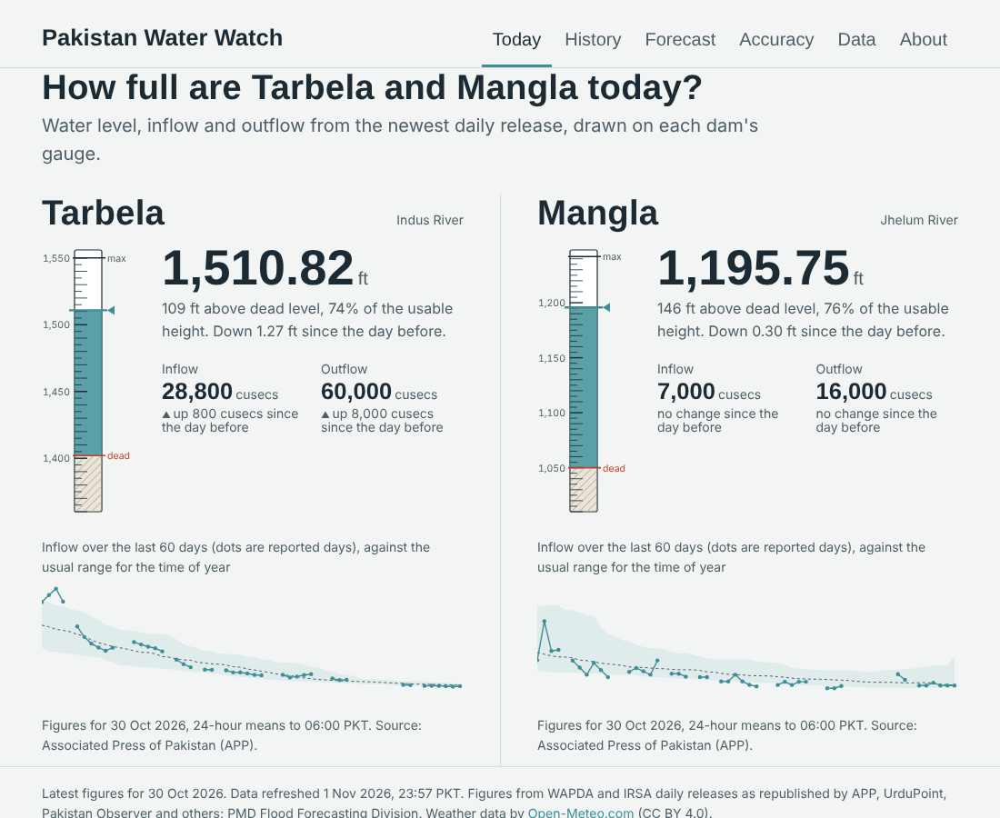
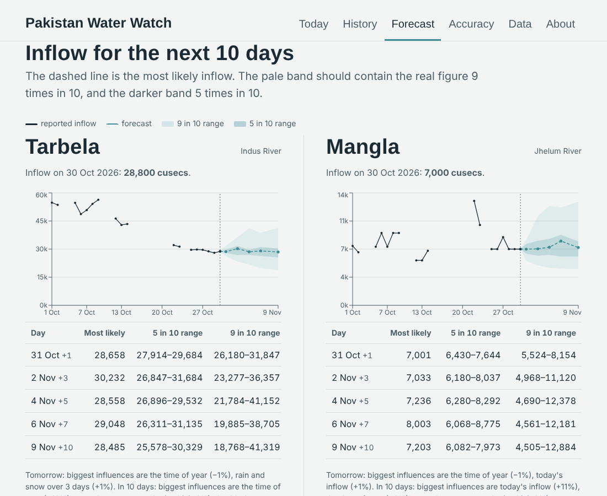
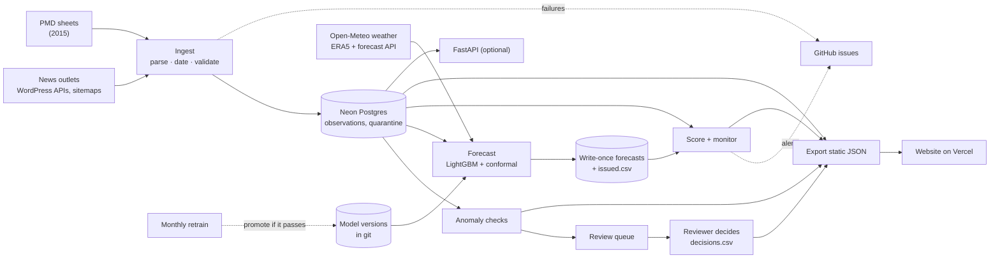
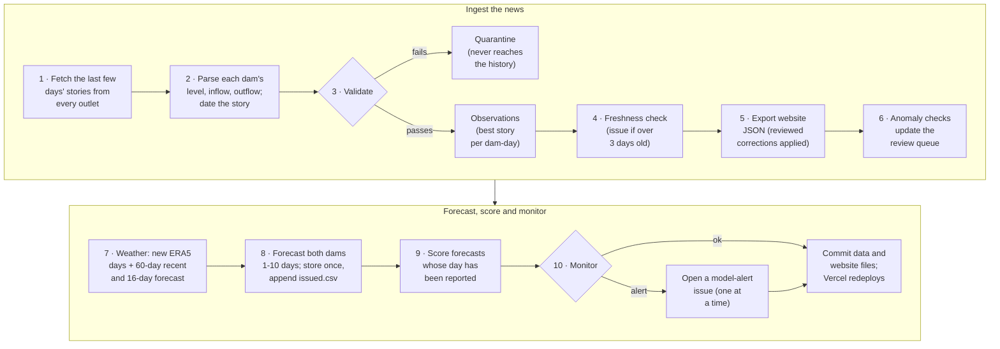
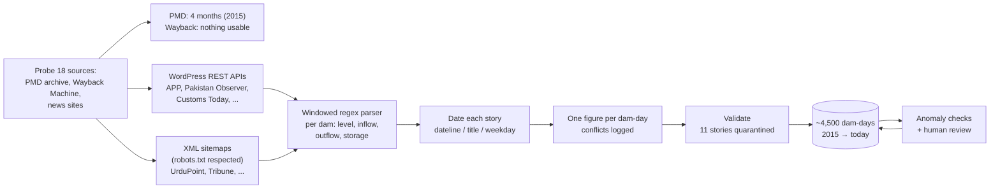
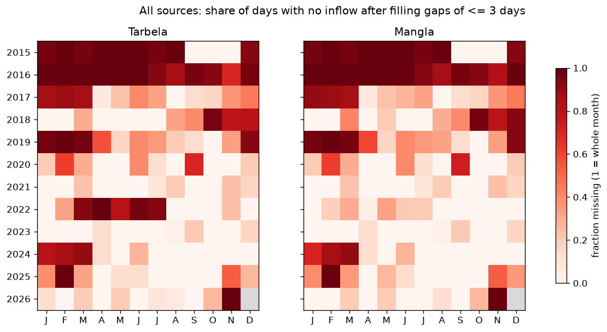
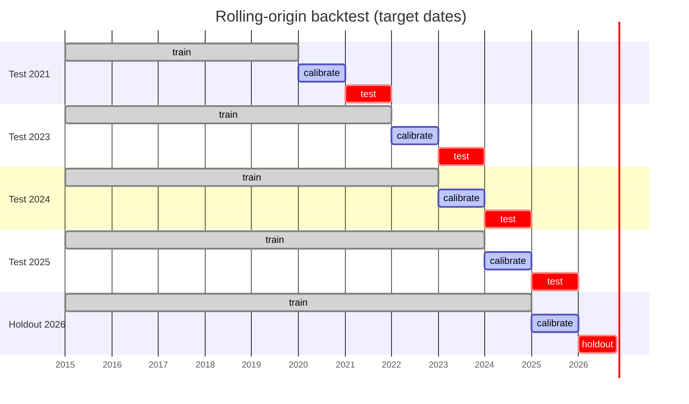
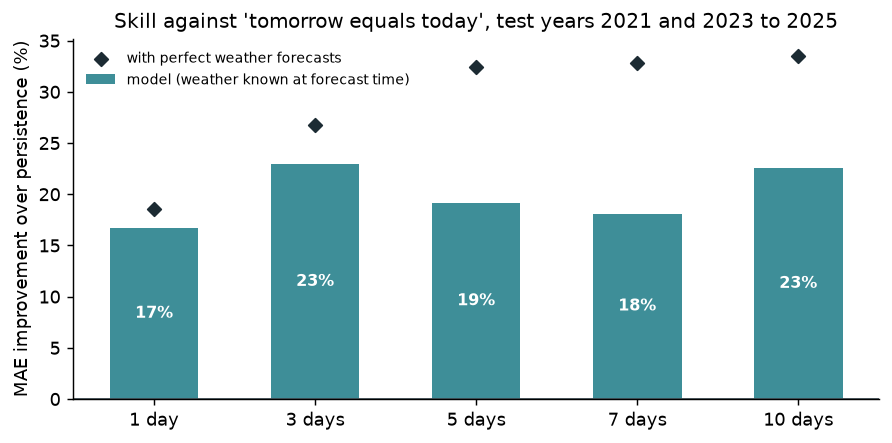
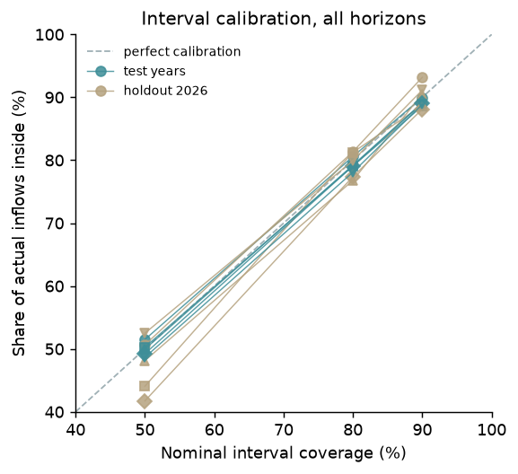
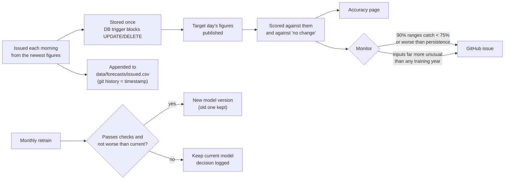

# Pakistan Water Watch

[](https://github.com/arooj-zehra/pakistan-water-watch/actions/workflows/ci.yml)
[](https://github.com/arooj-zehra/pakistan-water-watch/actions/workflows/daily_ingest.yml)
[](https://github.com/arooj-zehra/pakistan-water-watch/actions/workflows/retrain.yml)
[](https://pakistan-water-watch.vercel.app)
[](LICENSE)

**A live tracker for Pakistan's two largest reservoirs, Tarbela and Mangla, with 1 to 10 day inflow forecasts, calibrated uncertainty, and a public, tamper-evident record of how those forecasts perform.**

**→ [pakistan-water-watch.vercel.app](https://pakistan-water-watch.vercel.app)**


## Results at a glance

| | |
| --- | --- |
| **Forecast skill** | 17–23% lower error than "tomorrow equals today" at every horizon from 1 to 10 days, in four test years the model never saw |
| **Calibrated uncertainty** | 90% ranges caught 88–93% of real inflows on the 2026 holdout (target 85–95%) |
| **Prospective evaluation** | Every forecast since 1 Nov 2026 is stored before its day, can't be edited, and is scored automatically when the figures come in |
| **Rebuilt history** | ~4,500 dam-days from 2015 to today, reconstructed from 9 news outlets after the official archive turned out to hold four months |
| **Data quality** | Four anomaly checks catch 76% of planted typing errors big enough to matter; a reviewer decides, and decisions apply everywhere |
| **Running cost** | Zero: GitHub Actions, Neon Postgres (free tier), Vercel, Open-Meteo |

## Contents

- [Why this exists](#why-this-exists)
- [What the site shows](#what-the-site-shows)
- [How it works](#how-it-works)
- [Rebuilding the history from the news](#rebuilding-the-history-from-the-news)
- [The forecasting model](#the-forecasting-model)
- [Live, prospective evaluation](#live-prospective-evaluation)
- [Catching bad data](#catching-bad-data)
- [Limitations](#limitations)
- [Run it yourself](#run-it-yourself)
- [Repository layout](#repository-layout)
- [Documentation](#documentation)
- [Credits and licences](#credits-and-licences)

## Why this exists

Tarbela on the Indus and Mangla on the Jhelum store the water that feeds much of the Indus Basin Irrigation System, and they generate a large share of the country's hydropower. Each morning WAPDA publishes their level, inflow and outflow, and the Indus River System Authority (IRSA) apportions water between the provinces with these figures in hand.

Those figures are easy to find for today and hard to find for any other day: there is no public archive of daily reservoir data, no public forecast, and no record of how well anyone's expectations matched what the rivers did. This project builds all three in the open:

1. **A daily history** reconstructed from a decade of news reports, with every number traceable to its source article.
2. **Forecasts** of inflow 1, 3, 5, 7 and 10 days ahead, with ranges that are honest about uncertainty.
3. **A live track record**: forecasts are fixed before the day they describe and scored afterwards, so the claimed accuracy can be checked by anyone.

## What the site shows

| Page | What you see |
| --- | --- |
| **Today** | Each dam's level drawn on its gauge between dead level and maximum, inflow and outflow with day-on-day change, and the last 60 days against the usual range |
| **History** | Any year against the 10th–90th percentile range for each day of the year, with a second year to compare |
| **Forecast** | The next 10 days as a fan chart (5-in-10 and 9-in-10 ranges), a table, and the main influences behind each forecast in plain words |
| **Accuracy** | Live scores by horizon against "no change", how often the ranges caught the real value, recent forecasts against what came in, and health checks |
| **Data** | Download the full history as CSV; sources and how much each contributed |
| **Review queue** | Suspicious values, rejected stories and outlet disagreements waiting for a decision |

<table>
<tr>
<td width="50%"></td>
<td width="50%"></td>
</tr>
<tr>
<td><b>Today</b>: levels on each dam's gauge</td>
<td><b>Forecast</b>: 10-day fan chart with calibrated ranges</td>
</tr>
</table>

## How it works

The whole system runs on free services. GitHub Actions runs every step below each morning (and the retrain monthly), the database is Neon's free Postgres, and the website is a static React build on Vercel that reads JSON files the daily job commits to the repository, so the site keeps working even if every other service is asleep.



**The daily job, step by step** (`.github/workflows/daily_ingest.yml`):



## Rebuilding the history from the news

The original plan assumed the PMD Flood Forecasting Division's monthly sheets would supply ten years of daily data. Probing every month since 2010 found **4 sheets, all from late 2015**. The Internet Archive had no more. So the history had to be rebuilt from the daily IRSA/WAPDA figures that news agencies republish.



What made it work, and what had to be solved along the way:

- **Finding the stories.** Twelve outlets carried the daily figures and nine contributed to the history. WordPress sites expose every post through `/wp-json/wp/v2/posts`; others were found through their XML sitemaps, filtered on whole words (an early filter matched "Lok Virsa" and "oil and gas reservoirs"). Requests are spaced 2 seconds apart, identify the project, and respect `robots.txt`.
- **Parsing inconsistent prose.** The same release is retyped by each outlet: "inflow 28,800 cusecs and outflow 60,000", "inflows and outflows 28,800 and 60,000 cusecs respectively", "224, 700". The parser reads a window around each dam's name and handles paired, reversed and split numbers; typos like `4,8461` are rejected rather than guessed.
- **Dating stories correctly.** Pakistan Observer reprints the release the next morning. Dating by publication time left 295 days disagreeing with other outlets; reading the weekday named in the story ("on Monday") cut that to 28, and 402 of 408 shared days now match exactly.
- **Learning the dead levels.** Tarbela's dead level has risen with sedimentation (1,380 → 1,402 ft). Rather than hard-coding it, the pipeline reads it from the stories themselves and accepts a new value only if it is higher than the last, which stopped misreads from flip-flopping it.
- **Choosing between outlets.** When outlets disagree, the best story wins (APP first) and the disagreement is logged: 73 dam-days, most under 5% (reporting time or rounding).
- **Being traceable.** Every number in the history links to its article in `data/inventory/news_parsed.csv`, and raw snapshots are committed so anything can be re-parsed.

**Coverage**, the share of days with a figure after linear filling of gaps of 3 days or less (both dams):

| 2017 | 2018 | 2019 | 2020 | 2021 | 2022 | 2023 | 2024 | 2025 | 2026 so far |
| --- | --- | --- | --- | --- | --- | --- | --- | --- | --- |
| 61% | 66% | 49% | 79% | **92%** | 57% | **96%** | 75% | 75% | 90% |



The original go/no-go gate (five complete years under 10% missing) was not met, so it was revised before modelling began, and recorded: at least **2 years under 10% missing to test on** (2021 and 2023) and **5 years at least 75% present to train on** (2020, 2021, 2023, 2024, 2025). The full story is in [docs/DATA_CARD.md](docs/DATA_CARD.md).

## The forecasting model

**What it predicts:** daily mean inflow (cusecs, the 24 hours to 06:00 PKT) at each dam, 1, 3, 5, 7 and 10 days ahead, with 50%, 80% and 90% ranges.

**How:**

- **LightGBM quantile regression**, one set of models per horizon, both dams pooled with a station feature. Seven quantiles per horizon (5th to 95th percentile).
- **Target:** log(inflow on the target day) − log(inflow today). Predicting zero *is* the persistence forecast, so every bit of skill is measured against "no change".
- **Features:** today's inflow and level; changes over 1 to 14 days; 3, 7 and 30-day averages; how many recent days were actually reported; season; and catchment weather from ERA5 at 10 points in the upper Indus and Jhelum basins: positive degree-days (melt), temperature, rain and snowfall over 3 to 30 days.
- **No look-ahead:** weather features end the day before the forecast; targets are reported values only, never filled ones.
- **Calibrated ranges:** conformalized quantile regression (Romano et al., 2019). Each range is widened or narrowed so it achieves its stated coverage on a calibration year the model didn't train on.
- **Explanations:** each forecast lists its biggest influences using LightGBM's built-in SHAP values, e.g. "the time of year (−1%), warmth over two weeks (melt) (+4%)".

**How it was tested.** Each test year is forecast by models trained only on earlier years, with ranges calibrated on the year before:



**Results, test years 2021 and 2023–2025 pooled** (mean absolute error in cusecs):

| Horizon | Forecasts | Model | Persistence | Climatology | Same day last year | NSE | Skill vs persistence | 90% range caught |
| --- | --- | --- | --- | --- | --- | --- | --- | --- |
| 1 day | 2,066 | **4,083** | 4,901 | 13,955 | 16,711 | 0.980 | **17%** | 90% |
| 3 days | 2,003 | **7,380** | 9,575 | 13,979 | 16,647 | 0.953 | **23%** | 89% |
| 5 days | 1,977 | **10,093** | 12,483 | 13,992 | 16,503 | 0.910 | **19%** | 89% |
| 7 days | 1,976 | **12,038** | 14,702 | 14,053 | 16,544 | 0.883 | **18%** | 89% |
| 10 days | 1,950 | **13,486** | 17,409 | 14,116 | 17,030 | 0.857 | **23%** | 89% |

**Final holdout, 2026 to 30 October** (not used to choose any setting):

| Horizon | Skill vs persistence | 50% range caught | 80% caught | 90% caught |
| --- | --- | --- | --- | --- |
| 1 day | 35% | 50% | 81% | 93% |
| 3 days | 31% | 44% | 81% | 89% |
| 5 days | 22% | 48% | 77% | 90% |
| 7 days | 14% | 42% | 77% | 88% |
| 10 days | 29% | 53% | 80% | 91% |

<table>
<tr>
<td width="60%"></td>
<td width="40%"></td>
</tr>
</table>

**The look-ahead trap, made explicit.** A model given the *actual* weather of the forecast window (which nobody can know in advance) reaches 32–34% skill at 5–10 days instead of 18–23%. That gap is the most that adding weather forecasts could buy, and it is reported rather than hidden.

What it learned is sensible: at 1 day the recent change in inflow dominates; at 10 days, the time of year, today's inflow, and two weeks of warmth over the glaciers. Details, by-season results and all caveats are in the [model card](docs/MODEL_CARD.md); the backtest can be rerun in Colab with [`notebooks/03_backtest.ipynb`](https://colab.research.google.com/github/arooj-zehra/pakistan-water-watch/blob/main/notebooks/03_backtest.ipynb).

## Live, prospective evaluation

A backtest can be tuned, consciously or not, until it looks good. A forecast written down before the day it describes cannot. So from 1 November 2026 every forecast is:



- **Tamper-evident.** The `forecasts` table rejects updates and deletes at the database level, and the same rows are committed daily to [`data/forecasts/issued.csv`](data/forecasts/issued.csv). Its commit history shows when every line was written.
- **Scored honestly.** If the same day is ever forecast twice (say, by a new model version), only the first one counts.
- **Monitored.** Alerts fire if the 90% ranges catch under 75% of outcomes or the model does worse than persistence over the last 60 days. Drift is judged against history: a fixed PSI cut-off (0.25) would have fired in almost every past autumn, so an alert needs recent inputs to be far more unusual than the same season was in *any* training year. Replaying 2023–2025, it would have flagged Tarbela in August 2025, when melt-season temperatures were unlike any training year.
- **Retrained with a promotion check.** On the 2nd of each month a candidate is trained on all data to date. It replaces the production model only if it beats persistence at 3+ days, its holdout coverage is within 80–97%, and its average skill isn't more than 2 points below the current model's. Every decision is logged in `models/results/retrain_log.json`.
- **Weather lag handled.** ERA5 runs about 5 days behind. The newest days come from Open-Meteo's forecast API, bias-corrected against ERA5 over the last 60 days (at Gilgit the forecast model runs 3.4 °C warm, for example). If even that fails, weather features carry forward up to 7 days and the forecast says so.

The live record is young: the first scores arrive in November, in the low-flow season. The melt season from April is the real test, and the [Accuracy page](https://pakistan-water-watch.vercel.app/accuracy) will show it as it happens.

## Catching bad data

Most errors in a news-sourced history are typing errors: a digit wrong, two digits swapped, "40 thousand" read as 40, inflow and outflow swapped, one dam's figure given to the other. Four checks look for them (`pipeline/anomaly.py`):

| Check | Idea |
| --- | --- |
| **Local** | Robust z-score against a Theil-Sen trend line through the 7 days either side (15 where data is thin), so a lake rising a foot a day isn't mistaken for noise |
| **Seasonal** | STL removes the yearly cycle, then the same spike test runs on what's left |
| **Isolation Forest** | Each day's changes and residuals across level, inflow and outflow together |
| **Water balance** | The level must move the way inflow minus outflow says, given the lake's area at that level. A swapped or mistyped flow breaks it |

A value is queued when the evidence adds up (two strong signals, or one strong and two moderate) or the local check alone is extreme, *unless* the day before or after reports nearly the same figure, because two stories rarely repeat a typo. Nothing changes automatically: a person decides with `python -m pipeline.review`, decisions go in `data/review/decisions.csv`, and they apply everywhere the data is read (website, API, model training, live scoring).

**Tested by planting errors.** 20 realistic typos were planted at random clean days of the real history, ten times over ([full report](docs/ANOMALY_REPORT.md)):

| Kind of error | Caught |
| --- | --- |
| A digit dropped (145,000 → 14,500) or doubled | 29 of 30 |
| Inflow and outflow swapped | 80% |
| Level typo (1,510.82 → 1,501.82) | 78% |
| The other dam's inflow | 67% |
| Two digits swapped / one digit wrong | 40% / 22% (most change the value under 15%) |
| **All errors big enough to matter** (flow off ≥15%, level off ≥1 ft) | **76%** |

Of the 11 stories the loading rules had already rejected, the checks would independently have caught 8. On the real history they queue about 28 values per 1,000 dam-days; the obvious ones (outflows of 35 and 40 cusecs between days of 35,000) have been corrected, and the rest wait on the [review queue](https://pakistan-water-watch.vercel.app/review).

Tuning this on the real data mattered: the first version, using a plain median, missed 10 ft level typos whenever the lake was filling (the trend inflated the spread); the trend line lifted big-error recall from 71% to 83% in tuning. The consecutive-day rule cut false alarms by 21% at no cost in recall.

## Limitations

Stated plainly, because they matter more than the headline numbers.

**Data**

- **The history has holes.** January–March 2024, February 2025, October–December 2025 (both dams) and February–July 2022 (Tarbela) are largely missing; 2017–2019 are thin. Gaps over 3 days are left empty, never invented.
- **It comes from news reports, not instruments.** Figures are WAPDA's, retyped by journalists. The anomaly checks catch most large typos but not small ones (a slip from 28,800 to 28,300 is indistinguishable from a real change), and errors repeated for several days look like real changes.
- **One reviewer.** Review decisions are one person's judgement, recorded and reversible, but not independently checked.
- **Outflows are operator decisions**, so they are recorded but not modelled or forecast.

**Model**

- **Weather comes from 10 grid points (~25 km), not glacier stations.** ERA5 at that resolution reads warmer than the ice that actually melts; the model only needs the signal to move with melt.
- **No weather forecasts are used yet.** The perfect-weather experiment shows up to ~15 points of skill at 5–10 days are left on the table; the daily job now archives the 16-day forecast so a future version can learn from forecasts as they were issued, without look-ahead.
- **The 50% ranges run slightly narrow** on the 2026 holdout (42–53% caught). The 90% ranges, the ones the plan targets, are on target.
- **Extremes are rare in eight years of data.** A flood season beyond anything in training could be badly under-forecast, and the ranges would not know it. The drift monitor is there to say when conditions are unprecedented.
- **The climate is not stationary.** Glacier melt in the upper Indus is changing; a model trained on 2015–2025 assumes the next years behave similarly. Monthly retraining limits but doesn't remove this.
- **Inflow forecasts only.** Levels depend on release decisions, so they aren't forecast.

**Evaluation and operations**

- **The live record is days old.** The backtest is solid, but the prospective record that really counts needs a full melt season before it means much.
- **Backtest years are not all equal.** 2021 and 2023 are near-complete; 2024 and 2025 have gaps, so their scores rest on fewer days.
- **Free-tier infrastructure.** The FastAPI service isn't hosted (the free hosts that remain require a card); the static site covers everything it would. A news outlet changing its format stops ingestion until the parser is updated, though the job opens an issue the same morning.
- **Not an official source.** This is an independent student project. For operational decisions, use WAPDA and IRSA.

## Run it yourself

Needs Python 3.10+ and Node 20+. Commands are for Windows Command Prompt; on macOS/Linux use `source .venv/bin/activate`.

```cmd
git clone https://github.com/arooj-zehra/pakistan-water-watch.git
cd pakistan-water-watch
python -m venv .venv
.venv\Scripts\activate
pip install -r requirements.txt
python -m pytest -q
```

Without a `DATABASE_URL` everything runs on a local SQLite file (`data/pww.db`), rebuilt from the committed raw files:

```cmd
rem Load the PMD sheets and ERA5 history, then every cached news story
python -m pipeline.db init
python -m pipeline.backfill
python -m pipeline.backfill_news

rem Coverage and the go/no-go gate, then the website's JSON files
python -m pipeline.coverage_report
python -m pipeline.export_static
```

Models, forecasts and data quality:

```cmd
rem Backtest, production models and the model card (about 4 minutes)
python -m models.backtest

rem Newest weather, then today's forecasts; models.daily is what the daily job runs
python -m pipeline.fetch_weather --recent
python -m models.predict --print
python -m models.daily

rem Build the review queue, decide items in the terminal, evaluate the checks (about 2 minutes)
python -m pipeline.anomaly --print
python -m pipeline.review
python -m pipeline.anomaly_eval
```

The website (http://localhost:5173) and the API (http://127.0.0.1:8000/docs), each in its own window:

```cmd
cd web
npm install
npm run dev
```

```cmd
uvicorn api.main:app --reload
```

To run it in the cloud like the live site: create a free [Neon](https://neon.tech) database, add its connection string as the `DATABASE_URL` repository secret, connect the repo to [Vercel](https://vercel.com) with root directory `web`, and the workflows in `.github/workflows/` do the rest.

## Repository layout

```
pipeline/            ingestion, parsing, validation, database, exports, anomaly checks, review tool
  sources/             one module per source (news WordPress APIs, sitemaps, PMD, Open-Meteo)
models/              features, training, conformal calibration, backtest, live forecasting, retrain
  artifacts/           production model versions (gzipped LightGBM text models + meta.json)
  results/             backtest predictions and scores, retrain decision log
api/                 FastAPI app (same queries as the static export)
web/                 React + Vite site; web/public/data holds the JSON the daily job writes
notebooks/           Google Colab notebooks: data coverage, backtest
data/
  raw/                 raw source snapshots (re-parse without re-downloading)
  inventory/           parsed stories, outlet conflicts, evaluation results
  weather/             ERA5 history and recent weather per point
  forecasts/           issued.csv, the public forecast record
  review/              decisions.csv, reviewed corrections
docs/                model card, data card, anomaly report, data inventory, figures
tests/               110 tests (pytest); CI runs them and builds the site on every push
.github/workflows/   ci, daily_ingest, monthly_retrain
```

## Documentation

| Document | What's in it |
| --- | --- |
| [Model card](docs/MODEL_CARD.md) | Model, features, backtest by year and season, calibration, intended use, caveats |
| [Data card](docs/DATA_CARD.md) | Sources, fields and units, coverage, collection and validation, known gaps and biases |
| [Anomaly report](docs/ANOMALY_REPORT.md) | The four checks and how they did on planted errors, quarantined stories and outlet disagreements |
| [Data inventory](docs/data_inventory.md) | Source details and the auto-generated coverage tables |
| [Coverage notebook](https://colab.research.google.com/github/arooj-zehra/pakistan-water-watch/blob/main/notebooks/00_coverage.ipynb) | How much history exists, in Colab |
| [Backtest notebook](https://colab.research.google.com/github/arooj-zehra/pakistan-water-watch/blob/main/notebooks/03_backtest.ipynb) | Results, charts, one test year up close, today's forecast, in Colab |

## Credits and licences

- **Reservoir figures:** WAPDA and IRSA daily releases, as republished by the Associated Press of Pakistan, UrduPoint, Pakistan Observer, Customs Today, Daily Times, Express Tribune, Energy Update, Daily Ausaf and Profit; Pakistan Meteorological Department, Flood Forecasting Division. Every figure links back to its article in `data/inventory/news_parsed.csv`.
- **Weather:** [Open-Meteo.com](https://open-meteo.com/) (CC BY 4.0), ERA5 reanalysis from the Copernicus Climate Change Service.
- **Methods:** conformalized quantile regression (Romano, Patterson and Candès, 2019); LightGBM; STL (Cleveland et al., 1990); Isolation Forest (Liu, Ting and Zhou, 2008).
- **Code:** [MIT](LICENSE), © 2026 Arooj Zehra.

Built by **Arooj Zehra**, an independent project, not affiliated with WAPDA, IRSA or PMD.
