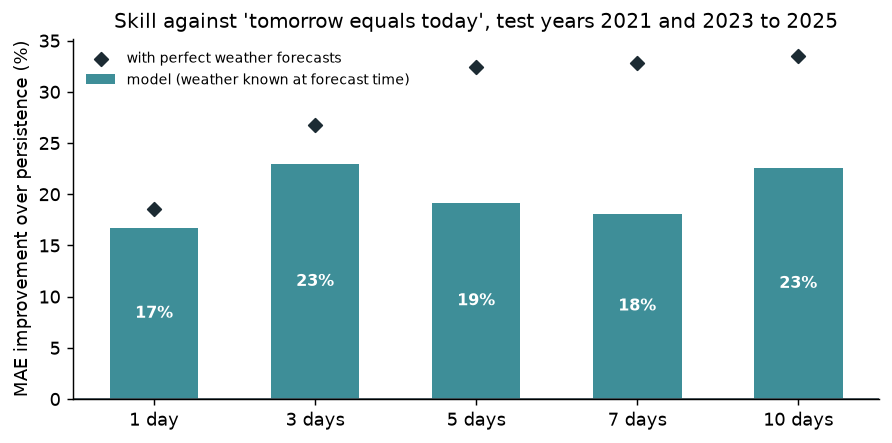
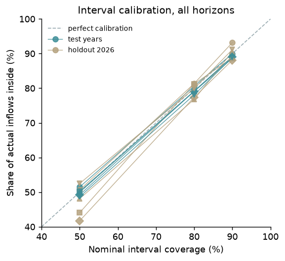

# Model card: inflow forecasts

_Generated by `python -m models.backtest`; numbers update on every run._

## What it forecasts

Daily mean inflow (cusecs, 24 hours to 06:00 PKT) at Tarbela (Indus) and Mangla (Jhelum), 1, 3, 5, 7, 10 days ahead, with calibrated 50%, 80% and 90% intervals.

## Intended use

- **For:** a public, independent view of where inflows are likely heading over the next ten days, with honest uncertainty; research and teaching about forecasting snow- and glacier-fed rivers; a worked example of prospective, tamper-evident forecast evaluation.
- **Not for:** operational reservoir management, flood warning or any safety decision. Use WAPDA, IRSA and the PMD Flood Forecasting Division. The model forecasts inflow only, not levels or releases.
- **Users should know:** the ranges are calibrated on past years; in conditions unlike any training year they can be too narrow (the drift monitor flags such periods on the Accuracy page).

## Data

Daily history rebuilt from news reports of the WAPDA/IRSA release, 2015 to today, with gaps; see the [data card](DATA_CARD.md). Weather: Open-Meteo ERA5 at 10 points in the upper Indus and Jhelum basins.

## Model

- LightGBM quantile regression, one set of models per horizon, both dams pooled (a station feature).
- Target: log(inflow on the target day) minus log(inflow today), so predicting zero is the persistence forecast.
- Features: today's inflow and level, changes over 1 to 14 days, rolling means, how many of the last 14 days were observed, season, and catchment weather from ERA5 (positive degree-days, temperature, precipitation and snowfall over 3 to 30 days, ending the day before the forecast).
- Intervals: conformalized quantile regression on the year before the test year (Romano et al., 2019).
- Production version `v20261102` (commit `d9f7b32`), data through 2026-11-02.

## Backtest

Each test year is predicted by models trained only on earlier years, with the intervals calibrated on the year before it. Targets are observed values only, never interpolated ones.

| Horizon | Rows | MAE model (cusecs) | MAE persistence | MAE climatology | MAE seasonal naive | NSE | Skill vs persistence | 90% coverage |
| --- | --- | --- | --- | --- | --- | --- | --- | --- |
| 1 d | 2066 | 4,083 | 4,901 | 13,955 | 16,711 | 0.980 | 17% | 90% |
| 3 d | 2003 | 7,380 | 9,575 | 13,979 | 16,647 | 0.953 | 23% | 89% |
| 5 d | 1977 | 10,093 | 12,483 | 13,992 | 16,503 | 0.910 | 19% | 89% |
| 7 d | 1976 | 12,038 | 14,702 | 14,053 | 16,544 | 0.883 | 18% | 89% |
| 10 d | 1950 | 13,486 | 17,409 | 14,116 | 17,030 | 0.857 | 23% | 89% |

Test years 2021, 2023, 2024 and 2025 pooled. Skill = 1 − MAE(model) / MAE(persistence).

### Final holdout: 2026 so far

| Horizon | Rows | MAE model | MAE persistence | Skill | 50% cov. | 80% cov. | 90% cov. | Median 90% width |
| --- | --- | --- | --- | --- | --- | --- | --- | --- |
| 1 d | 381 | 3,128 | 4,798 | 35% | 51% | 81% | 93% | ±17% of today's inflow |
| 3 d | 363 | 7,444 | 10,773 | 31% | 44% | 81% | 89% | ±33% of today's inflow |
| 5 d | 349 | 10,916 | 14,040 | 22% | 48% | 77% | 91% | ±45% of today's inflow |
| 7 d | 345 | 12,670 | 14,743 | 14% | 42% | 77% | 88% | ±49% of today's inflow |
| 10 d | 339 | 12,005 | 16,845 | 29% | 53% | 80% | 91% | ±53% of today's inflow |

### By season (test years pooled)

| Horizon | Season | MAE model | Skill vs persistence | 90% coverage |
| --- | --- | --- | --- | --- |
| 1 d | low flow (Oct-Mar) | 1,310 | 10% | 92% |
| 1 d | melt (Apr-Sep) | 6,339 | 18% | 89% |
| 3 d | low flow (Oct-Mar) | 2,245 | 18% | 92% |
| 3 d | melt (Apr-Sep) | 11,537 | 24% | 86% |
| 5 d | low flow (Oct-Mar) | 2,550 | 24% | 93% |
| 5 d | melt (Apr-Sep) | 16,157 | 18% | 86% |
| 7 d | low flow (Oct-Mar) | 2,950 | 25% | 92% |
| 7 d | melt (Apr-Sep) | 19,306 | 17% | 87% |
| 10 d | low flow (Oct-Mar) | 3,416 | 31% | 93% |
| 10 d | melt (Apr-Sep) | 21,365 | 21% | 86% |

### The look-ahead trap

The live model uses only weather known when the forecast is made. The oracle variant is also given the actual weather of the forecast window, which no forecast can know; the gap between them is the most that better weather forecasts could add.

| Horizon | Skill, live | Skill, perfect weather | 90% coverage, live | 90% coverage, perfect weather |
| --- | --- | --- | --- | --- |
| 1 d | 17% | 19% | 90% | 90% |
| 3 d | 23% | 27% | 89% | 89% |
| 5 d | 19% | 32% | 89% | 88% |
| 7 d | 18% | 33% | 89% | 88% |
| 10 d | 23% | 34% | 89% | 89% |

## What drives the forecasts

Mean absolute SHAP contribution (LightGBM `pred_contrib`) of the production median models:

- **1 day:** `d1`, `log_q0`, `precip3`, `observed0`, `doy_cos`, `d3`
- **10 days:** `doy_sin`, `doy_cos`, `log_q0`, `pdd14`, `rm30`, `precip3`

## Live evaluation and versioning

- Every live forecast is stored once in a database table that rejects edits and deletions, and appended to [`data/forecasts/issued.csv`](../data/forecasts/issued.csv), whose git history timestamps it.
- Forecasts are scored automatically when their day's figures are published, against the reported value and against persistence; results are on the [Accuracy page](https://pakistan-water-watch.vercel.app/accuracy).
- Alerts open a GitHub issue if the 90% intervals catch under 75% of outcomes, the model does worse than persistence over 60 days, or recent inputs are far more unusual than the same season in any training year.
- A candidate model is retrained monthly and replaces this one only if it beats persistence at 3+ days, keeps holdout 90% coverage within 80-97%, and is not more than 2 points of skill worse; decisions are logged in `models/results/retrain_log.json`. Each version's files and metadata are kept in `models/artifacts/`.

## Limitations

- History is rebuilt from news stories: 2024 Q1, February 2025, October to December 2025, and Tarbela from February to July 2022 are missing (see the [data card](DATA_CARD.md)).
- ERA5 runs about 5 days behind real time. Live forecasts fill the newest days from Open-Meteo's forecast API, bias-corrected against ERA5 over the last 60 days; the backtest used ERA5 only, so live skill may be a little lower.
- Weather comes from 10 grid points (~25 km), not from stations on the glaciers.
- Outflow decisions (dam operations) are not modelled; inflow is a natural flow and is not affected by them.
- On the 2026 holdout the 50% intervals held 42-53% of outcomes; the 50% and 80% intervals were calibrated the same way as the 90% ones but are less stable with a year of calibration data.
- Training spans about eight usable years; floods or droughts beyond that range may be badly under-forecast, and the intervals would not know it.
- Glacier melt in the upper Indus is changing over time; monthly retraining limits but does not remove the risk that the past is a poor guide.
- Prospective scoring of live forecasts starts in November 2026, in the low-flow season; the melt season from April onward is the real test.

## Responsible use

This is an independent student project, not an official forecast. It publishes its full track record, including misses, so its reliability can be judged rather than assumed. Report problems on [GitHub](https://github.com/arooj-zehra/pakistan-water-watch/issues).
