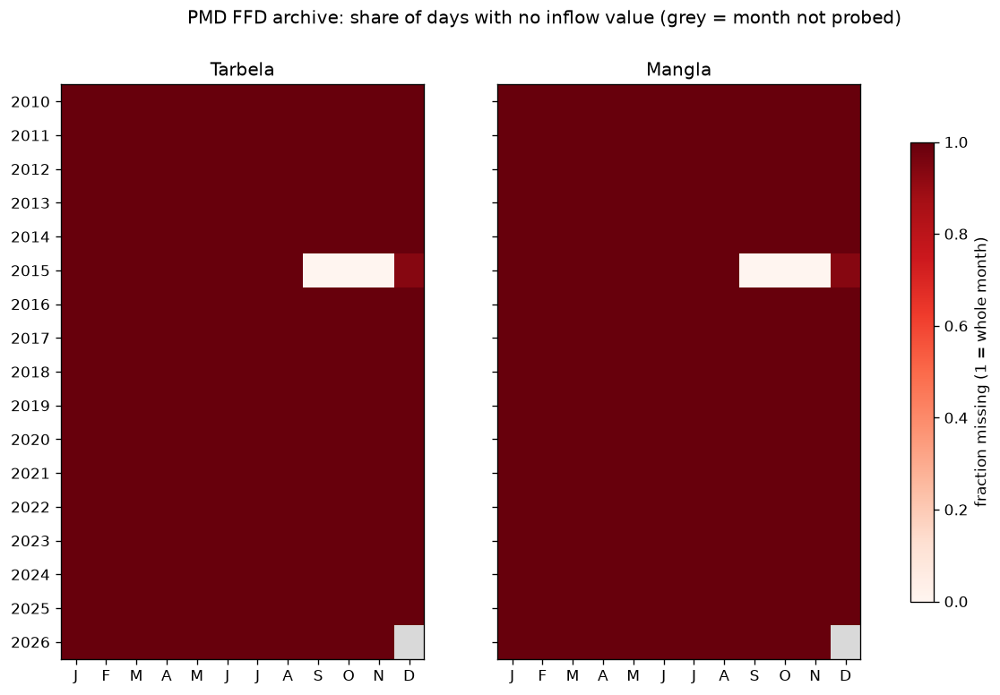
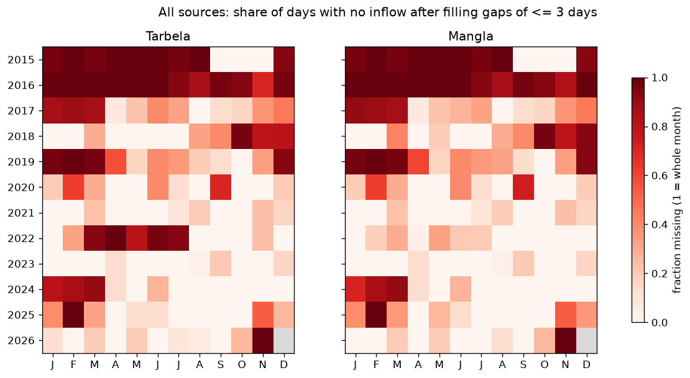

# Data inventory

What data exists, where it comes from, how much of it there is, and the rules
for collecting it. The coverage table at the bottom is regenerated by
`python -m pipeline.coverage_report`; everything else is written by hand.

## Sources

| Source | What | Resolution | Access | Licence / terms | Status |
| --- | --- | --- | --- | --- | --- |
| PMD Flood Forecasting Division monthly sheets | Tarbela & Mangla level (ft), mean inflow & outflow (cusecs), measured 06:00 PST | Daily, one HTML page per month (`damsMMMYY_files/sheet001.htm`) | Public HTML, no API | Government data, credit PMD FFD | Only 4 sheets exist (Sep–Dec 2015); loaded |
| WAPDA/IRSA daily release as republished by news outlets | Level, inflow, outflow, live storage (MAF) for Tarbela and Mangla | Daily; flows are 24-hour means | WordPress REST APIs and XML sitemaps | Credit WAPDA and the outlet | Main source: 9 outlets contribute, see [DATA_CARD.md](DATA_CARD.md) |
| Open-Meteo Historical API (ERA5) | Daily tmax/tmin/tmean (°C), precipitation (mm), snowfall (cm) | ~25 km grid, from 1940, ~5 day lag | Free, no key | CC BY 4.0, credit Open-Meteo | `pipeline.fetch_weather` |
| Open-Meteo Forecast API | Same variables | Last 60 days + 16 days ahead | Free, no key | CC BY 4.0 | Daily job: fills ERA5's lag for forecasts; forecasts archived |

## Weather points

Defined in `pipeline/config.py`. Upper Indus → Tarbela: Gilgit, Skardu, Astore,
Hunza, Leh. Upper Jhelum → Mangla: Srinagar, Pahalgam, Muzaffarabad, Naran,
Kel. ERA5 cells are ~25 km, so high-altitude points read warmer than the
glaciers that actually melt; the model only needs the signal to move with
melt, not to be exact.

## Known quirks

- **Dead level changes over time** (Tarbela 1,380 → 1,386 → 1,392 → 1,398 →
  1,402 ft, from sedimentation). Stored per date in `dead_levels`, never
  hard-coded, and learned from the stories themselves (a new value is accepted
  only if higher than the last). The dates are when each value first appears
  in the news, not official change dates; see [DATA_CARD.md](DATA_CARD.md).
- **Mangla's maximum level was raised** (to 1,242 ft, 2009-12), so historical
  levels above the old maximum are not errors in recent years.
- PMD sheets are sometimes only partly filled (Dec 2015 had 2 of 31 days).
- PMD and WAPDA flows are both 24-hour means to 06:00 PST, so the two sources
  should agree; disagreements are logged.

## Collection rules

- At most one request per page per day, 2 s between requests, User-Agent names
  this project and links the repo.
- Raw HTML is saved under `data/raw/` so everything can be re-parsed without
  downloading again.
- Sitemap sites: `robots.txt` is read before any article is fetched, and
  disallowed paths are skipped (`pipeline/backfill_html.py` reports how many).
  WordPress REST API endpoints (`/wp-json/wp/v2/posts`) are public read-only
  interfaces the sites publish. Open-Meteo is used within its free,
  non-commercial tier and credited (CC BY 4.0).

## Parser tests

The news parser is tested on story text in the formats outlets actually use
(`tests/test_backfill_news.py`, `tests/test_sitemaps_and_html.py`), including
paired, reversed and split numbers and next-day reprints. The
`tests/fixtures/press_releases/synthetic_*.txt` files test the original
press-release parser and are written to match the official format.

<!-- AUTO-START: generated by pipeline/coverage_report.py, do not edit by hand -->

### PMD archive coverage (auto-generated)

**NO-GO (PMD archive only): 0 complete year(s) with <10% missing for both dams (need 5). Longest consecutive run: none.**

Probed 203 months, 2010-01 to 2026-11. Sheets found: 4; missing or failed: 199.

| Year | Months found | Tarbela days | Mangla days | Worst % missing |
| --- | --- | --- | --- | --- |
| 2010 | 0/12 | 0/365 | 0/365 | 100% |
| 2011 | 0/12 | 0/365 | 0/365 | 100% |
| 2012 | 0/12 | 0/366 | 0/366 | 100% |
| 2013 | 0/12 | 0/365 | 0/365 | 100% |
| 2014 | 0/12 | 0/365 | 0/365 | 100% |
| 2015 | 4/12 | 93/365 | 93/365 | 75% |
| 2016 | 0/12 | 0/366 | 0/366 | 100% |
| 2017 | 0/12 | 0/365 | 0/365 | 100% |
| 2018 | 0/12 | 0/365 | 0/365 | 100% |
| 2019 | 0/12 | 0/365 | 0/365 | 100% |
| 2020 | 0/12 | 0/366 | 0/366 | 100% |
| 2021 | 0/12 | 0/365 | 0/365 | 100% |
| 2022 | 0/12 | 0/365 | 0/365 | 100% |
| 2023 | 0/12 | 0/365 | 0/365 | 100% |
| 2024 | 0/12 | 0/366 | 0/366 | 100% |
| 2025 | 0/12 | 0/365 | 0/365 | 100% |
| 2026 | 0/11 | 0/334 | 0/334 | 100% |

### All sources in the database (auto-generated)

**GO (revised gate): backtest years under 10% missing: 2021, 2023 (need 2); training years with 75%+ present: 2020, 2021, 2023, 2024, 2025 (need 5).**

Original gate (5 years under 10% missing), for reference: NO-GO (all sources, gaps <= 3 days filled): 2 complete year(s) with <10% missing for both dams (need 5). Longest consecutive run: 2021-2021 (1 yrs).

As recorded, without filling: NO-GO (all sources, as recorded): 0 complete year(s) with <10% missing for both dams (need 5). Longest consecutive run: none.

| Source | Dam-days with inflow | First | Last |
| --- | --- | --- | --- |
| app | 1685 | 2017-07-22 | 2026-10-30 |
| customstoday | 210 | 2015-01-23 | 2018-07-25 |
| dailyausaf | 1 | 2025-05-17 | 2025-05-17 |
| dailytimes | 9 | 2017-01-30 | 2022-08-20 |
| energyupdate | 3 | 2021-09-07 | 2025-04-03 |
| pakobserver | 783 | 2019-07-29 | 2026-08-01 |
| pmd | 182 | 2015-09-01 | 2015-12-02 |
| profit | 1 | 2018-08-21 | 2018-08-21 |
| tribune | 8 | 2018-03-23 | 2025-08-17 |
| urdupoint | 1609 | 2016-07-22 | 2026-10-28 |

Gaps of up to 3 days between two known values are filled by linear interpolation for the second set of columns; longer gaps stay empty.

| Year | Tarbela days | Mangla days | Worst % missing | After filling short gaps |
| --- | --- | --- | --- | --- |
| 2015 | 96/365 | 96/365 | 74% | 74% |
| 2016 | 15/366 | 13/366 | 96% | 96% |
| 2017 | 150/365 | 150/365 | 59% | 39% |
| 2018 | 170/365 | 166/365 | 55% | 34% |
| 2019 | 118/365 | 114/365 | 69% | 51% |
| 2020 | 234/366 | 233/366 | 36% | 21% |
| 2021 | 270/365 | 273/365 | 26% | 8% ✅ |
| 2022 | 171/365 | 261/365 | 53% | 43% |
| 2023 | 306/365 | 324/365 | 16% | 4% ✅ |
| 2024 | 262/366 | 263/366 | 28% | 25% |
| 2025 | 210/365 | 206/365 | 44% | 25% |
| 2026 (year so far) | 195/305 | 195/305 | 36% | 10% |

<!-- AUTO-END -->
